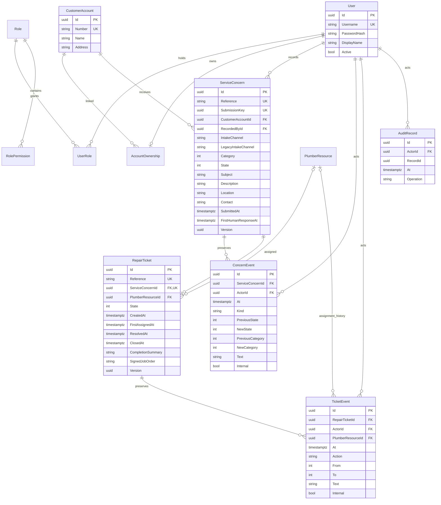

# Implemented relational model

This reflects InitialScope, Phase2Concerns and the current model snapshot, not an unverified Midterm ERD. UUID primary keys are internal; ordinary UI flows show references and string account numbers. Role has an integer key. Join entities use composite keys. All foreign keys use Restrict deletion.

AuditRecord.RecordId is an intentional polymorphic reference (concern or ticket), not an unconstrained account owner. The required actor is a foreign key; domain event tables provide the strict per-record foreign keys. Search and queue indexes cover category/state, account/time, reference uniqueness, and event record/time. See the migration for exact column types, limits, requiredness, and constraints.

Phase 2 categories and intake channels are domain enums constrained on the concern table, rather than editable lookup tables. Human responses are append-only ConcernEvent rows (Kind = Human response); a separate ConcernResponse table is unnecessary. State/category before/after values are nullable for pre-migration history; legacy evidence is preserved without inventing past state changes. Internal visibility is stored per event. The first response timestamp is nullable; Version is an EF concurrency token. Reference values default from concern_reference_seq; gaps on rollback are expected. SubmissionKey uniquely identifies a retriable form submission. Repair tables/relationships are retained for Phase 3; Phase 2 cannot create or update repair tickets.
