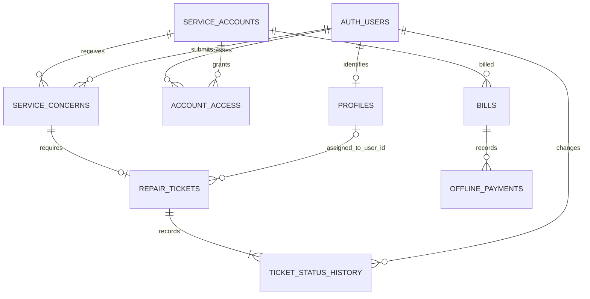

# Shared database contract

## Current deployment status

On 2026-11-25, the secure live connection and database credentials were verified with the project CA certificate. The public schema was inspected and exported without row data. The user approved the desktop workflow rules; a private public-schema/data backup was validated, and RepairWorkflow plus StaffDirectoryAccess were applied successfully. Original record counts and consumer policies were preserved. See live-database-integration.md for exact migration IDs, evidence and remaining account-provisioning checks.

The historical inspection notes below describe the earlier anonymous API check; full catalog/column-grant verification has now superseded those uncertainties.

## Original inspection status

Read-only requests on 2026-11-24 reached the configured Supabase project. Its public JWKS contains an ES256 key. Requests using the supplied publishable key without a signed-in user returned HTTP 401 / PostgreSQL code 42501 for the eight tables below. The OpenAPI root requires a secret key. No operational rows were retrieved and no database writes were performed.

This confirms the request boundary denies anonymous access. It does not verify column types, relationships, RLS expressions, grants, triggers or staff-role support. Do not grant anonymous access to work around this result. Supply a PostgreSQL connection to the local inspection tool or run `desktop/database/inspect.sql` in an authorized SQL session.

## Consumer source contract

These names come from `lib/main.dart` at `d8a48e4`, not from a full database catalog inspection.

| Table | Referenced columns / behavior |
|---|---|
| profiles | user_id, display_name, role, active; mobile accepts admin and client |
| service_accounts | id, account_number, holder_name, service_address, active, updated_by |
| account_access | user_id, account_id, active; consumer expects at most one active link |
| service_concerns | id, account_id, submitted_by, category, subject, description, status, admin_response, reviewed_by, reviewed_at, created_at |
| repair_tickets | id, concern_id, assigned_to, status, latest_update, created_by, updated_by, updated_at; mobile treats assigned_to as display text |
| bills | id, account_id, bill_number, billing_period_start, billing_period_end, due_date, amount_due, created_by |
| offline_payments | bill_id, receipt_reference, payment_date, amount_paid, verified_by, verified_at |
| announcements | id, title, message, published, created_by, updated_at |

## Implemented target relationships

The diagram describes the target integration. Verify existing keys and cardinality before creating migrations. `assigned_to_user_id` and `ticket_status_history` are migration additions; preserve the existing text assignment and summary columns for mobile compatibility.

## Migration and authorization strategy

1. Inspect column types/defaults, profile constraints, unique concern relationship, foreign keys, indexes, policies and triggers using the read-only catalog query. Do not infer UUID keys from Dart strings.
2. Back up and reproduce the relevant schema in a disposable PostgreSQL development database. One shared operational database serves mobile and desktop; test databases are separate.
3. Map existing tables and exclude externally managed Supabase Auth objects from EF migrations. The initial `profiles` mapping is provisional and excluded from migrations until verified.
4. Keep one reviewed migration history for desktop-owned schema additions. Do not call EnsureCreated, reset the database, or automatically migrate on application startup. Use a design-time factory and reviewed migration scripts.
5. Extend the existing profile role constraint/enum to support staff only after examining its actual definition. Verify consumers cannot edit their own role or active flag. Provision staff/admin roles with an authorized operator; never trust signup metadata as permission.
6. Add a staff identity link without reinterpreting existing assignment text. Preserve mobile summary fields and update history atomically in later workflow sessions.
7. Protect new history/assignment data with appropriate RLS and grants. Audit every existing mobile/admin write path so it cannot bypass transaction/history rules.

Session 2's full live schema verification and any staff database changes remain pending authorized PostgreSQL catalog access. The publishable key alone does not grant that access.

## Implemented workflow migration

The RepairWorkflow EF migration adds `service_concerns.repair_dispatched_at`, `repair_tickets.assigned_to_user_id`, a unique concern/ticket index and `ticket_status_history`. Base-table key assumptions are UUID and PostgreSQL timestamptz; preflight rejects incompatible catalog types. Existing profile role constraints and RLS require individual review.

History stores a monotonically ordered event ID, ticket, actor, status, note, assignment and server timestamp. PostgreSQL triggers validate all workflow writers, append history and update the concern within the same transaction. Current ticket fields remain compatible with consumer reads. Existing free-text assignments are linked only when exactly one active Staff display name matches; unresolved legacy assignments require Admin reassignment. Existing tickets receive one labelled upgrade snapshot.

Ticket transitions are Open ? Assigned ? In progress ? Resolved, with same-state notes/reassignment allowed before resolution. Staff may update their own assigned work; only Admin creates/assigns. Closed/Resolved concerns cannot be reviewed again and linked concerns are updated through their ticket. History cannot be modified/deleted through normal processing. Consumer submissions remain Submitted until office review.

The mobile app's old office mutation buttons now direct personnel to the desktop; its consumer submission, concern response and ticket-summary queries retain their original contract. Consumer category values are Water supply, Billing inquiry, Repair request and Other. The guarded migration has been verified on a source-contract reconstruction in local PostgreSQL, not on the unavailable production catalog.
